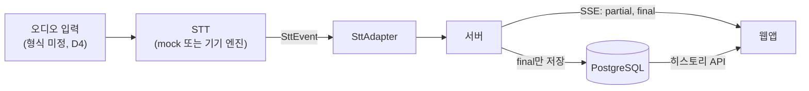

# 프로젝트 설명 — speech-transcriber

마지막 갱신: 2026-11-09 · 이광호

이 문서는 프로젝트가 무엇이고 어떻게 구성되는지 설명합니다. 확정된 내용만 적고, 아직 만들지 않은 부분은 작업 번호와 함께 '예정'으로 표시합니다. 작업 목록과 진행 상황은 [`TODO.md`](../TODO.md)가 기준입니다.

## 무엇을 만드는가

**온디바이스 스피치 트랜스크라이버**입니다. 녹음을 기기 안에서 STT(음성 인식)로 처리해 웹앱과 동기화하는 독립형 기기이고, 하드웨어는 Rubik Pi입니다. 경희대학교 캡스톤디자인(14주, 3인 팀) 프로젝트입니다.

이 저장소는 **앱(웹앱 + 백엔드) 전용**입니다.

| 파트 | 담당 |
| --- | --- |
| 앱(웹앱 + 백엔드) | 이광호 |
| 하드웨어 | 김범수 |
| AI 모델 | 박지윤 |

## 핵심 기능

1. 녹음 → 온디바이스 STT → 노트
2. 실시간 자막/트랜스크립트 화면
3. 세션 히스토리 조회·다운로드

AI 요약, 화자 분리, 검색, 배터리 내장 휴대형, 모드 전환(일반 녹음/AI 질의)은 확장 기능이며 핵심 기능보다 먼저 만들지 않습니다.

## 전체 구성

음성이 텍스트가 되어 화면과 DB에 닿기까지의 흐름입니다.



| 구성 요소 | 위치 | 역할 | 상태 |
| --- | --- | --- | --- |
| STT 어댑터 | `apps/server/src/stt` | STT 구현체와 서버 사이의 경계. 서버의 다른 코드는 `SttAdapter` 인터페이스만 봅니다 | 구현됨 (T05). 웹 '녹음 시작'은 `STT_MODE`로 고른 구현체를 씀: 기본 mock, `local`이면 노트북에서 실제 모델 엔진을 띄우는 실험용 구현체 (T28). 기기가 세션을 시작하면 기기 결과를 받는 `DeviceSttAdapter`를 씀 (T20) |
| 실제 STT | AI 파트 `stt-engine` 저장소 (비공개) | 기기 안에서 음성을 인식합니다. `audiostackd`에게서 오디오를 받아 결과를 돌려주고, 데몬이 결과를 서버로 보냅니다 | 엔진은 보드 NPU에서 동작함(AI 파트, 2026-11-09). 서버는 데몬이 보낸 결과를 `/api/device/sessions`로 받아 세션에 넣음 (T20, 박지윤의 web-app PR #1 병합). 노트북에서 ONNX 엔진과 `feed_wav.py`로 웹 자막, DB, 히스토리, 내보내기까지 확인함 (T29, T20). 실제 데몬과 보드에서는 T26에서 확인. 수신 경로 이름은 하드웨어 파트 동의가 남음 (T19) |
| 서버 | `apps/server` | 세션 시작/종료, SSE 전달, DB 저장, 히스토리 API | Express 서버가 뜨고 `GET /health`, 공통 에러 응답(`{ error: { code, message } }`), pg 연결 풀이 있음 (T04). 세션 시작·종료 API가 있고 시작하면 mock STT가 켜짐 (T06). final 세그먼트를 DB에 저장함 (T08). 녹음 중인 세션의 이벤트를 SSE로 보냄 (T07). 히스토리 목록·상세 API가 있음 (T10). 스트림에 다시 접속하면 빠진 final을 먼저 보냄 (T09). 끝난 세션을 txt·md 파일로 내보냄 (T11). 기기 결과 수신 경로 `/api/device/sessions` (T20) |
| DB | `docker-compose.yml` (노트북 개발용) | 세션과 세그먼트를 저장합니다 | 로컬 PostgreSQL 16 컨테이너가 뜸 (T02). 스키마와 마이그레이션 있음 (T03). 세션은 저장함 (T06). 세그먼트도 저장함 (T08). 기기에서의 구성은 미정 (D5, D8) |
| 웹앱 | `apps/web` | 녹음 제어, 실시간 트랜스크립트, 히스토리 화면 | Vite + React 뼈대. 화면 주소(녹음, 히스토리 목록·상세), API 클라이언트, 서버로 넘기는 개발 서버 프록시가 있음 (T12). 녹음 화면에 녹음 상태와 보조 시작·종료 버튼 (T13). 녹음하지 않는 동안 2초마다 진행 중인 녹음 확인 (T20). 녹음 중에는 버튼 아래에 실시간 자막 (T14). 자막 스트림이 끊기면 맨 위 배너와 자동 재연결, 위쪽 서버 상태는 30초마다 다시 확인 (T15). 히스토리 목록, 문장별 시각이 붙은 상세, txt·md 내려받기 버튼 (T16) |
| 공용 타입 | `packages/shared` | 서버와 웹이 함께 쓰는 타입과 상수 | `APP_NAME`, `SttEvent`, `Session`, `SessionSummary`, `Segment`, `SessionStreamMessage`, `STREAM_HEARTBEAT_MS`, `ExportFormat`, `EXPORT_FORMATS` |

## 기술 결정

| 항목 | 결정 |
| --- | --- |
| 클라이언트 | React 웹앱 |
| 웹앱 빌드 도구 | Vite. 라우팅은 React Router, 서버 호출은 `fetch` 래퍼. 개발 중에는 Vite 프록시로 서버에 연결 (CORS 없음) |
| 백엔드 | Node.js + TypeScript, npm workspaces 모노레포 |
| Node | 22 (`.nvmrc`의 22.22.0). Node 20 지원 종료로 2026-10-30에 올림 (T25) |
| 서버 프레임워크 | Express |
| 실시간 전달 | SSE로 시작, 추후 WebSocket 전환을 고려해 설계 |
| 사용자 모델 | 단일 사용자, 로그인 없음 |
| DB | PostgreSQL, `pg` 라이브러리로 직접 SQL 작성 (ORM 사용 안 함) |
| SSE 끊김 | 자동 재연결 + 화면 상단 배너 알림 |
| 히스토리 다운로드 포맷 | txt와 md 둘 다 (D6, 2026-10-27) |
| 개발 환경 | 노트북에서 먼저 개발. STT·DB 주소는 환경변수로 분리 |
| STT | Node 내부 mock STT로 시작해 실제 STT로 교체 |
| 테스트 | Vitest 5, 핵심 로직만(내보내기 포매터, 이벤트 재개, 세그먼트 병합). 루트에서 `npm test` (T17) |
| 백엔드 위치 | Rubik Pi 안을 목표로 설계. 실측 결과에 따라 SQLite 또는 별도 서버로 바뀔 수 있음 |
| 기기 OS | Rubik Pi 3에 Ubuntu for Qualcomm (하드웨어 파트 결정). AI 파트가 측정한 보드는 Ubuntu 24.04 (2026-11-09) |
| STT 엔진 | `seastar105/whisper-small-komixv2`를 QNN으로 변환해 NPU에서 실행. `audiostackd`의 `engine.sock`에 접속하는 별도 프로그램(`stt-engine` 저장소). 결과 형식과 세션 처리 규칙은 `stt-engine`의 `ENGINE_CONTRACT.md` (AI 파트 결정, 2026-11-09) |
| 엔진 입력 오디오 | 16 kHz 모노 S16_LE를 20 ms(640바이트)씩. 마이크는 `audiostackd`만 열고, 앱 서버는 오디오를 다루지 않음 (하드웨어 파트 구현) |
| 엔진 결과 처리 | `segmentId`는 서버가 세션마다 0부터 붙임(엔진 `seg_id`는 쓰지 않음). 빈 final(`empty: true`)은 버림. 기기가 세션을 바꾸면 앞 세션을 `ended`로 닫고 늦은 final을 30초 동안 저장 (앱 파트 결정, 2026-11-09, T19) |

아직 정해지지 않은 것은 다음과 같습니다. 결정 번호는 `TODO.md`의 표기입니다.

- STT 연동 방식: 녹음 시작·종료 주체와 세션 번호 발급, 서버의 수신 경로 (D4, 하드웨어 파트 합의가 남음). 엔진 결과 형식과 오디오 형식은 정해짐
- Rubik Pi 입출력 구성(마이크는 3.5 mm 포트를 쓸 계획), 기기 수령 시점 (D5, 하드웨어 파트 협의)
- 팀 전체 마일스톤과 주차별 일정 (D7)
- PostgreSQL 메모리 설정, SQLite 전환 여부 (D8, 기기 실측 후)

## 폴더 구조

```text
speech-transcriber/
├─ TODO.md                    # 작업 목록과 작업 기록
├─ package.json               # npm workspaces, 공통 스크립트
├─ tsconfig.base.json         # 공통 컴파일러 옵션
├─ .env.example               # PORT, DB_URL, STT_URL, STT_MODE, LOCAL_STT_* (복사해서 .env로 씀)
├─ .nvmrc                     # 개발 Node 판 (22.22.0)
├─ .npmrc                     # engine-strict=true (다른 Node 판에서는 설치 실패)
├─ docker-compose.yml         # 로컬 개발용 PostgreSQL 16
├─ vitest.config.ts           # Vitest 설정 (테스트를 찾는 범위, node 환경)
├─ apps/
│  ├─ server/                 # @app/server — Node.js 백엔드
│  │  ├─ migrations/
│  │  │  ├─ 001_init.sql      # 스키마 v0 (sessions, segments)
│  │  │  ├─ 002_session_status.sql  # sessions.status 컬럼
│  │  │  └─ 003_device_session.sql  # sessions.device_session_id 컬럼 (T20)
│  │  └─ src/
│  │     ├─ index.ts          # 진입점 (listen, 남은 세션 정리, 종료 처리)
│  │     ├─ app.ts            # Express 앱 조립 (/health, /api/sessions, /api/device/sessions, 404·에러 처리)
│  │     ├─ config/
│  │     │  └─ env.ts         # 환경변수 로더 (STT_MODE와 실험용 엔진 경로 포함)
│  │     ├─ db/
│  │     │  ├─ pool.ts        # pg 연결 풀
│  │     │  └─ migrate.ts     # 마이그레이션 실행 스크립트
│  │     ├─ device/           # 기기(audiostackd) 결과 수신 (T20, web-app PR #1)
│  │     │  ├─ routes.ts      # 수신 경로 3개. 2xx나 503으로만 답함
│  │     │  ├─ ingest.ts      # 기기 세션을 서버 세션에 잇기 (세션 교체, 늦은 final 30초)
│  │     │  └─ convert.ts     # 기기 결과 한 건을 SttEvent로 (segmentId, 시각, 빈 final 버림)
│  │     ├─ export/
│  │     │  └─ format.ts      # 히스토리 내보내기 포매터 (txt, md). 시각·길이·상태 표시는 shared의 format.ts
│  │     ├─ http/
│  │     │  ├─ errors.ts      # HttpError, 404·에러 처리 미들웨어
│  │     │  └─ sse.ts         # SSE 응답 하나 (헤더, id 줄, data 한 줄 JSON, heartbeat)
│  │     ├─ segments/
│  │     │  ├─ repository.ts  # segments 테이블을 읽고 쓰는 SQL
│  │     │  └─ writer.ts      # 세션의 final을 순서대로 쓰고, 실패하면 다시 시도
│  │     ├─ sessions/
│  │     │  ├─ repository.ts  # sessions 테이블 SQL (히스토리 목록 포함)
│  │     │  ├─ manager.ts     # 진행 중인 세션, 상태 전이, STT 어댑터 연결, 세그먼트 저장 연결, 스트림 구독과 이어받기
│  │     │  └─ routes.ts      # 세션 API, 스트림, 히스토리 라우트 (내보내기 포함)
│  │     └─ stt/
│  │        ├─ adapter.ts     # SttAdapter 인터페이스
│  │        ├─ mock.ts        # MockSttAdapter
│  │        ├─ local.ts       # LocalSttAdapter (T28 실험, 실제 모델 엔진을 자식 프로세스로 실행)
│  │        ├─ device.ts      # DeviceSttAdapter (T20, 수신 경로가 넣은 결과를 세션에 전달)
│  │        └─ demo.ts        # mock 이벤트 확인용 스크립트
│  └─ web/                    # @app/web — React 웹앱
│     ├─ index.html           # 웹앱 HTML (#root)
│     ├─ vite.config.ts       # Vite 설정. /api, /health를 서버로 넘기는 프록시
│     ├─ tsconfig.json        # 브라우저 코드(src) 타입 검사
│     ├─ tsconfig.node.json   # vite.config.ts 타입 검사
│     └─ src/
│        ├─ main.tsx          # 진입점 (라우터를 #root에 붙임)
│        ├─ router.tsx        # 화면 주소
│        ├─ api/
│        │  ├─ client.ts      # fetch 래퍼(JSON, 파일), ApiError
│        │  ├─ endpoints.ts   # 서버 API 함수 (/health, 세션 시작·종료·진행 중, 히스토리 목록·상세·내보내기)
│        │  ├─ useApiData.ts  # 화면에서 API 하나를 불러 쓰는 훅
│        │  ├─ useServerHealth.ts   # /health를 30초마다(실패하면 5초마다) 다시 확인하는 훅
│        │  └─ useSessionStream.ts  # 세션 스트림(SSE)을 구독해 자막 상태로 쓰는 훅, 끊김 감지와 다시 연결
│        ├─ components/
│        │  ├─ ConnectionBanner.tsx # 자막 스트림 연결 배너 (끊김, 다시 연결됨)
│        │  ├─ DownloadButtons.tsx  # 히스토리 상세의 txt·md 내려받기 버튼
│        │  ├─ Layout.tsx     # 공통 틀 (메뉴, 서버 상태)
│        │  └─ Transcript.tsx # 실시간 자막 (final 목록, 흐린 partial 한 줄, 자동 스크롤)
│        └─ pages/            # 녹음, 히스토리 목록·상세, 없는 주소 화면
├─ packages/
│  └─ shared/                 # @app/shared — 서버·웹 공용 타입과 상수
│     └─ src/
│        ├─ index.ts
│        ├─ export.ts         # ExportFormat 타입, EXPORT_FORMATS (내보내기 형식)
│        ├─ format.ts         # 시작 시각, 문장 앞 시각, 녹음 길이, 상태 이름 (내보내기 파일과 히스토리 화면이 같이 씀)
│        ├─ segment.ts        # Segment 타입 (저장된 세그먼트)
│        ├─ session.ts        # Session, SessionSummary 타입
│        ├─ stream.ts         # SessionStreamMessage 타입, heartbeat 간격
│        └─ stt.ts            # SttEvent 타입
└─ docs/
   ├─ project-overview.md     # 이 문서
   ├─ device-ingest.md        # 보드 없이 Mac에서 기기 연동을 시험하는 방법 (web-app PR #1)
   ├─ guides/                 # 작업별 지침서 (Txx.md)
   └─ logs/                   # 일자별 작업 기록 (YYYY-MM-DD.md)
```

단위 테스트는 테스트하는 파일 옆에 `*.test.ts`로 둡니다(T17). 지금은 `packages/shared/src/format.test.ts`, `apps/server/src/export/format.test.ts`, `apps/server/src/sessions/routes.test.ts`·`manager.test.ts`, `apps/server/src/device/convert.test.ts`(T20), `apps/web/src/api/useSessionStream.test.ts` 여섯 개입니다.

## 실행 방법

Node.js 22(`.nvmrc`의 22.22.0) 기준으로 개발합니다. nvm을 쓰면 루트에서 `nvm use`로 맞춥니다. `.npmrc`의 `engine-strict` 때문에 다른 판에서는 `npm install`·`npm ci`가 `EBADENGINE`으로 실패합니다. DB는 Docker Desktop이 켜져 있어야 뜹니다.

```bash
npm install          # 루트에서 한 번
cp .env.example .env # 처음 한 번. .env가 없으면 dev:server가 실행되지 않음
docker compose up -d # 로컬 PostgreSQL 실행 (끌 때는 docker compose down)
npm run db:migrate   # 아직 적용하지 않은 마이그레이션 실행 (다시 실행해도 안전)
npm run typecheck    # 모든 워크스페이스 타입 검사
npm test             # 핵심 로직 단위 테스트 (DB와 Docker 없이 돎)
npm run dev:server   # 서버 실행 (끌 때는 Ctrl+C)
npm run dev:web      # 웹앱 개발 서버 실행 (http://localhost:5173, 서버도 켜 둠)
npm run dev:stt      # mock STT 이벤트를 콘솔에 출력
```

`npm test`는 루트 `vitest.config.ts`에 따라 `apps/*/src`, `packages/*/src` 아래의 `*.test.ts`만 돌립니다. 저장소 안 `.claude/worktrees/`의 다른 작업 트리는 보지 않습니다. `SessionManager` 테스트는 DB 함수를 테스트 안에서 가짜로 바꾸므로 DB가 꺼져 있어도 됩니다. 고치면서 계속 돌려 보려면 `npx vitest`(감시 모드)를 씁니다(T17).

`dev:server`는 `.env`의 `PORT`(예시 값 3000)에서 요청을 받습니다. `curl localhost:3000/health`가 `{"status":"ok"}`를 내면 서버와 DB가 모두 살아 있는 것이고, DB에 연결하지 못하면 503을 냅니다. 없는 경로와 서버 오류는 모두 `{ "error": { "code", "message" } }` 모양의 JSON으로 응답합니다. 다른 API도 DB에 닿지 못해 실패하면 `503` `DB_UNAVAILABLE`로 답합니다(T13).

`PORT`, `DB_URL`, `STT_URL` 중 빠진 값이 있으면 `dev:server`는 빠진 변수 이름을 알리고 종료 코드 1로 끝납니다. `STT_MODE`는 비워 두면 mock이고, `local`이면 `LOCAL_STT_PYTHON`, `LOCAL_STT_SCRIPT`, `LOCAL_STT_WAV`도 있어야 합니다(빠지면 같은 방식으로 종료 코드 1). `docker compose down`은 데이터를 지우지 않습니다. 데이터까지 지우려면 `docker compose down -v`를 씁니다.

실제 모델로 받아쓰기를 해 보려면(T28 실험) 저장소 밖 `~/Desktop/stt-lab`의 가상환경과 엔진이 있어야 합니다. 준비 방법은 그 폴더의 `README.md`에 있습니다. 서버는 아래처럼 띄우며, 경로는 모두 절대 경로입니다. 웹에서 '녹음 시작'을 누르면 엔진이 모델을 불러오느라 시작까지 10초 가까이 걸립니다.

```bash
STT_MODE=local \
LOCAL_STT_PYTHON=$HOME/Desktop/stt-lab/.venv/bin/python \
LOCAL_STT_SCRIPT=$HOME/Desktop/stt-lab/stream_engine.py \
LOCAL_STT_WAV=$HOME/Desktop/stt-lab/samples/demo_long.wav \
npm run dev:server
```

## 웹앱

`npm run dev:web`으로 Vite 개발 서버를 띄우고 브라우저에서 `http://localhost:5173`을 엽니다(T12). 웹앱은 서버 API를 `/api/…`, `/health` 같은 같은 출처의 경로로 부르고, Vite 개발 서버가 이 요청을 루트 `.env`의 `PORT`에서 도는 서버로 넘깁니다. 그래서 서버에 CORS 설정이 없습니다. SSE 스트림도 이 프록시를 거쳐 그대로 옵니다. `.env`에 `PORT`가 없으면 Vite가 그 사실을 알리고 시작하지 않습니다.

| 주소 | 화면 | 상태 |
| --- | --- | --- |
| `/` | 녹음 | 녹음 상태와 보조 시작·종료 버튼 (T13), 녹음 중 실시간 자막 (T14) |
| `/history` | 히스토리 목록 | 끝난 녹음을 최근 것부터, 누르면 상세로 (T16) |
| `/history/:id` | 히스토리 상세 | 머리말(시작, 길이, 상태), txt·md 내려받기 버튼, 문장별 시각 (T16) |
| 그 밖의 주소 | 페이지를 찾을 수 없음 | |

모든 화면 위쪽에 메뉴와 서버 상태가 있습니다. 서버 상태는 `/health`를 불러 `정상`, `DB에 연결하지 못했습니다`, `서버에 연결하지 못했습니다`, `서버가 답하지 않습니다` 중 하나로 보여 줍니다. 웹앱을 열 때, 그 뒤 30초마다, 녹음 화면의 자막 스트림이 다시 연결될 때 다시 확인합니다(T15). 확인이 실패하면 성공할 때까지 5초마다 다시 확인하므로, 서버가 다시 켜지면 새로고침하지 않아도 늦어도 5초 안에 `정상`으로 돌아옵니다. `/health`가 5초 안에 답하지 않으면(서버가 멈춤) `서버가 답하지 않습니다`로 보입니다(T25). 다시 확인하는 동안에는 직전 결과를 그대로 보여 줍니다.

녹음 화면(T13)은 화면을 열 때 `GET /api/sessions/active`로 진행 중인 녹음을 확인합니다. 녹음 중이면 `녹음 중 · 01:23 (#12)`처럼 흐른 시간과 세션 번호를 보여 주고, 아니면 `녹음하고 있지 않습니다`를 보여 줍니다. 녹음의 주 제어는 기기의 물리 버튼이고, 화면의 '녹음 시작'·'녹음 종료' 버튼은 개발·시연·원격 종료용 보조 수단입니다.

| 상황 | 화면 |
| --- | --- |
| 웹에서 종료 성공 | `/history/:id`로 이동 (종료 응답과 스트림의 `ended` 중 먼저 온 쪽에서 한 번만) |
| 밖에서 종료(기기 버튼, 다른 탭) | 스트림의 `ended`를 받고 `/history/:id`로 이동 (T14) |
| 밖에서 시작(기기 버튼, 다른 탭) | 녹음하지 않는 동안 2초마다 진행 중인 녹음을 확인해, 2초 안에 `녹음 중`으로 바뀜 (T20) |
| 웹 버튼 녹음 중 기기가 새 세션을 시작함 | 서버가 웹 버튼 세션을 `interrupted`로 닫음. 끊김 배너가 잠깐 보인 뒤 같은 화면에 새 녹음과 `#5 녹음이 끝나, 진행 중인 녹음(#6)을 보여 줍니다`. 새 녹음이 끝나면 `/history/6` (T20) |
| 시작했는데 이미 녹음 중 (`409`) | 진행 중인 녹음을 다시 확인해 보여 주고 `이미 진행 중인 녹음이 있어 그 녹음을 보여 줍니다` |
| 종료했는데 이미 끝남 (`409`, `404`) | 다시 확인하고 `이미 끝난 녹음입니다 (#12)` |
| 시작·종료 중 DB가 꺼짐 (`503`) | `녹음을 시작하지 못했습니다: DB에 연결하지 못했습니다`, 또는 `녹음을 종료하지 못했습니다: … 잠시 뒤 다시 종료해 주세요`. 종료 실패 때는 녹음 중으로 남아 다시 누를 수 있음 |
| 서버가 꺼짐 | `녹음 상태를 확인하지 못했습니다: 서버에 연결하지 못했습니다`와 '다시 확인' 버튼 |

녹음 중에는 버튼 아래에 실시간 자막이 나옵니다(T14). `useSessionStream`이 `/api/sessions/:id/events`를 구독하고, `Transcript`가 그립니다.

| 상황 | 자막 |
| --- | --- |
| 아직 문장이 없음 | 흐린 `말을 기다리는 중…` |
| partial | 맨 아래 흐린 한 줄이 늘어남. 같은 `segmentId`의 final이 오면 그 자리에서 검은 글자로 바뀜 |
| final | 줄이 하나 늘어남. 같은 번호가 다시 오면 덮어쓰고, 확정된 번호의 늦은 partial은 무시 |
| 바닥(40px 안)을 보고 있음 | 새 문장을 따라 내려감 |
| 위로 올려 읽는 중 | 스크롤 위치를 그대로 둠 |
| 녹음 중 새로고침 | 서버가 지금까지의 final을 먼저 보내 다시 채워짐 (T09) |

자막 상자는 화면 높이의 60%까지 커지고 그 뒤로는 상자 안에서 스크롤합니다.

자막 스트림이 끊기면 녹음 화면 맨 위(스크롤해도 보임)에 배너가 나오고, 웹앱이 스스로 다시 연결합니다(T15). `error` 이벤트가 오거나 30초(heartbeat 간격의 2배) 동안 아무 메시지도 없으면 끊긴 것으로 봅니다. 다시 열기 전에는 `GET /api/sessions/active`로 같은 세션이 아직 녹음 중인지 확인합니다.

| 상황 | 화면 |
| --- | --- |
| 끊김 | `실시간 연결이 끊겼습니다. 다시 연결하는 중… (1번째 시도)`와 '지금 다시 연결' 버튼. 자막과 '녹음 종료' 버튼은 그대로 |
| 시도가 실패함 | 시도 번호가 늘고, 다음 시도까지 1, 2, 4, 8초, 그 뒤로는 10초마다 기다림. 횟수 제한 없음. 세션 확인은 5초 안에 답이 없으면 실패로 봄 |
| '지금 다시 연결' | 기다리던 시도를 바로 함 |
| 다시 연결됨 | `다시 연결되었습니다`를 3초 보이고 숨김. 서버가 지금까지의 final을 다시 보내 빠진 문장이 채워짐(같은 번호는 덮어써서 줄이 늘지 않음). 위쪽 서버 상태도 다시 확인 |
| 끊긴 사이에 녹음이 끝남(기기 버튼, curl) 또는 서버가 다시 켜져 `interrupted`로 닫힘 | 다음 시도에서 `/history/:id`로 이동. 다만 그때 다른 녹음이 진행 중이고 '녹음 종료'를 누른 것이 아니면, 히스토리로 가지 않고 그 녹음을 이어 보임 (T20) |

다시 연결을 `EventSource` 기본 동작에 맡기지 않는 이유는 '실시간 스트림' 절에 있습니다.

화면을 연 뒤 다른 탭이나 기기 버튼으로 시작한 녹음은 2초마다 `GET /api/sessions/active`로 확인해 반영합니다(T20). 녹음 중에 밖에서 종료한 것은 스트림의 `ended`로 바로 반영됩니다. 기기 세션 교체(`ended`)로 끝나면 지금은 새 세션을 따라가지 않고 히스토리로 갑니다(T27에서 다시 봄). 흐른 시간은 서버의 시작 시각과 브라우저 시계로 계산하므로 두 시계가 다르면 어긋납니다.

히스토리 화면(T16)은 지난 녹음을 보고 내려받는 곳입니다. 시작 시각, 길이, 상태, 문장 앞 시각은 내보내기 파일과 같은 함수(`packages/shared/src/format.ts`)로 써서, 화면과 내려받은 파일의 내용이 같습니다.

| 화면 | 보이는 것 |
| --- | --- |
| 목록 | `지난 녹음 N개`와 항목. 첫 줄 `#45 · 2026-10-23 09:53 · 문장 7개`(중단된 세션은 끝에 `중단됨`), 둘째 줄 첫 문장을 한 줄로 자름. 녹음이 없으면 `지난 녹음이 없습니다` |
| 상세 | `시작 2026-10-23 09:53 · 길이 6초 · 종료됨`, 'txt 내려받기'·'md 내려받기' 버튼, `[00:03] 문장`을 한 줄씩. 문장이 없으면 `저장된 문장이 없습니다` |
| 상세, 녹음 중인 세션 | 그때까지 저장된 문장. 버튼은 눌리지 않고 `녹음 중이라 아직 내려받을 수 없습니다`와 녹음 화면 링크. 주소로 직접 열 때만 생김 |
| 내려받기 | 내보내기 API를 `fetch`로 받아 서버가 정한 이름(`session-45.txt`)으로 저장. 받는 동안 누른 버튼이 `받는 중…` |
| 내려받기 실패 | `내려받지 못했습니다: DB에 연결하지 못했습니다`처럼 버튼 아래에 이유. 다시 누를 수 있음 |

내려받기를 `<a href>` 링크로 하지 않는 이유는 실패했을 때 이유를 화면에 보이기 위해서입니다. 링크로 받으면 브라우저 다운로드 목록에 '실패'로만 남습니다.

서버 API는 `src/api/endpoints.ts`의 함수로 부릅니다. 실패하면 서버가 보낸 `code`와 `message`를 담은 `ApiError`를 던지고, 서버에 닿지 못하면 `code`가 `NETWORK_ERROR`입니다.

```ts
import { listSessions } from './api/endpoints';
import { useApiData } from './api/useApiData';

const sessions = useApiData((signal) => listSessions(signal), []);
// sessions.status: 'loading' | 'success'(data) | 'error'(error: ApiError)
```

`npm run build -w @app/web`은 `apps/web/dist`에 정적 파일을 만듭니다. `npm run preview -w @app/web`(`http://localhost:4173`)으로 빌드 결과를 같은 프록시와 함께 볼 수 있습니다. 기기에서 빌드 결과를 누가 내보낼지(Express가 직접 내보낼지 등)는 아직 정하지 않았습니다.

## 세션 API

녹음 세션을 시작하고 끝내는 API입니다(T06). 단일 사용자라 진행 중인 세션은 한 번에 하나뿐입니다. 성공 응답은 `{ "session": … }`으로 감싸고, 에러는 `{ "error": { "code", "message" } }`로 응답합니다.

| 요청 | 하는 일 | 응답 |
| --- | --- | --- |
| `POST /api/sessions` | 세션을 만들고 STT를 켭니다 | `201`과 세션. 진행 중인 세션이 있으면 `409` `SESSION_ALREADY_ACTIVE` |
| `GET /api/sessions/active` | 진행 중인 세션을 알려 줍니다 | `200`과 세션. 없으면 `{"session":null}` |
| `POST /api/sessions/:id/stop` | STT를 끄고 세션을 닫습니다 | `200`과 세션. 없는 번호면 `404` `SESSION_NOT_FOUND`, 진행 중이 아니면 `409` `SESSION_NOT_ACTIVE`, 번호가 양의 정수가 아니면 `400` `INVALID_SESSION_ID` |

시작과 종료는 DB에 닿지 못하면 `503` `DB_UNAVAILABLE`입니다. 종료가 실패하면 세션은 녹음 중으로 남으므로, DB가 돌아온 뒤 같은 번호로 다시 종료하면 됩니다. `GET /api/sessions/active`는 서버 메모리만 읽어 DB가 꺼져 있어도 답합니다.

세션은 `{"id":1,"status":"recording","startedAt":"2026-10-13T01:29:37.747Z","endedAt":null}` 모양이고, 타입은 `packages/shared/src/session.ts`의 `Session`입니다.

| `status` | 뜻 |
| --- | --- |
| `recording` | 녹음 중. `endedAt`이 `null`입니다 |
| `ended` | 사용자나 기기가 종료했습니다. 기기의 `/end`와 기기 세션 교체도 이 상태로 닫힙니다 |
| `interrupted` | 사용자가 종료하지 않았는데 끊겼습니다. 녹음 중에 서버를 끄면 이 상태로 닫히고, 서버가 강제로 꺼져 닫지 못한 세션은 서버를 다시 켤 때 이 상태로 닫힙니다. 웹 버튼으로 시작한 세션은 기기가 새 세션을 시작해도 이 상태로 닫힙니다(T20). 화면과 내보낸 파일에는 이유 없이 `중단됨`으로 보입니다 |

```bash
curl -X POST localhost:3000/api/sessions          # 시작
curl localhost:3000/api/sessions/active           # 진행 중인 세션
curl -X POST localhost:3000/api/sessions/1/stop   # 종료 (1은 시작할 때 받은 id)
```

기기(물리 버튼)로 시작한 녹음은 아래 '기기 결과 수신 경로'로 들어옵니다. 웹 버튼으로 기기 녹음을 시작·종료하는 일은 T27(`ctrl.sock`)에서 합니다.

## 기기 결과 수신 경로

기기의 데몬(`audiostackd`)이 세션 통지와 엔진 결과를 HTTP로 보내는 곳입니다(T20, 박지윤의 web-app PR #1). 인식은 기기에서 하고, 서버는 받은 결과를 `DeviceSttAdapter`로 세션에 넣어 웹 자막, DB, 히스토리, 내보내기로 잇습니다. 형식과 변환 규칙은 [`T19.md`](guides/T19.md) '수신 경로'와 '결과를 `SttEvent`로 바꾸는 규칙', 보드 없이 시험하는 방법은 [`device-ingest.md`](device-ingest.md)에 있습니다. 경로 이름은 하드웨어 파트 동의가 남았습니다(T19).

| 요청 | 하는 일 | 응답 |
| --- | --- | --- |
| `POST /api/device/sessions` `{ session_id, … }` | 기기 세션을 서버 세션(정수 번호)에 잇습니다 | `201`과 `sessionId`. 같은 통지를 다시 받으면 `201` `already known` |
| `POST /api/device/sessions/:deviceId/transcripts` `{ seq, transcript }` | 결과 한 건을 `SttEvent`로 바꿔 세션에 넣습니다 | `202`와 `segmentId`. 버린 것은 `202`와 `ignored`(이미 받은 `seq`, 빈 final, 모르는 `type`, 모르는 기기 세션 등) |
| `POST /api/device/sessions/:deviceId/end` | 세션을 `ended`로 닫습니다 | `200`. 모르는 기기 세션도 `200` |

- **데몬은 2xx가 아니면 같은 요청을 맨 앞에 두고 계속 다시 보냅니다.** 그래서 서버는 2xx나 DB 장애의 `503` `DB_UNAVAILABLE`로만 답합니다. 본문이 JSON이 아니면 `400`입니다(알려진 것).
- **웹 버튼 세션이 진행 중일 때 기기 세션이 시작되면** 웹 버튼 세션을 `interrupted`로 닫고 기기 세션을 받습니다.
- **기기가 세션을 바꾸면**(`session rotate`) 앞 세션을 `ended`로 닫고, 그 기기 세션의 늦은 final을 30초 동안 DB에만 저장합니다(partial은 버림).
- **`/end`가 DB 장애로 실패하면** 세션을 녹음 중으로 남겨, 데몬이 다시 보낸 `/end`가 종료를 다시 시도합니다. DB가 돌아오면 밀린 final을 쓴 뒤 `ended`로 닫힙니다(T20).
- 시험: 서버만 띄우고 curl로 데몬을 흉내 낸 20단계와 그 결과는 [`T20.md`](guides/T20.md) '결과'에 있습니다.

## 실시간 스트림 (SSE)

녹음 중인 세션의 STT 이벤트를 웹앱에 실시간으로 보내는 엔드포인트입니다(T07). 끊겼다가 다시 접속하면 빠진 final을 먼저 보냅니다(T09).

| 요청 | 하는 일 | 응답 |
| --- | --- | --- |
| `GET /api/sessions/:id/events` | 진행 중인 세션의 이벤트를 SSE로 보냅니다 | `200`과 `text/event-stream`. 없는 번호면 `404` `SESSION_NOT_FOUND`, 진행 중이 아니면 `409` `SESSION_NOT_ACTIVE`, 번호가 양의 정수가 아니면 `400` `INVALID_SESSION_ID`, `Last-Event-ID`가 0 이상의 정수가 아니면 `400` `INVALID_LAST_EVENT_ID` (세션 API와 같은 에러 JSON) |

메시지는 모두 SSE의 기본 `message` 이벤트로 오고, `data` 한 줄에 JSON 하나입니다. 종류는 JSON의 `type`으로 구분하고, 타입은 `packages/shared/src/stream.ts`의 `SessionStreamMessage`입니다. 나중에 WebSocket으로 바꿔도 같은 JSON을 보냅니다.

| `type` | 언제 | 내용 |
| --- | --- | --- |
| `partial`, `final` | STT가 이벤트를 낼 때마다 | `SttEvent` 그대로 (아래 'STT 이벤트' 참고) |
| `heartbeat` | 접속한 뒤 15초마다 (`STREAM_HEARTBEAT_MS`) | 없음. 연결이 살아 있다는 표시입니다 |
| `ended` | 세션 종료가 성공했을 때 | `session`: 닫힌 세션. 이 메시지 뒤에 서버가 스트림을 닫습니다 |

```text
data: {"type":"partial","segmentId":0,"text":"안녕하세요","startMs":0,"endMs":200}

id: 0
data: {"type":"final","segmentId":0,"text":"안녕하세요 오늘 회의를 시작하겠습니다","startMs":0,"endMs":800}

data: {"type":"heartbeat"}

data: {"type":"ended","session":{"id":17,"status":"ended","startedAt":"2026-10-15T02:13:00.575Z","endedAt":"2026-10-15T02:13:06.625Z"}}
```

```bash
curl -X POST localhost:3000/api/sessions        # 시작. 응답의 id를 아래에 씀
curl -N localhost:3000/api/sessions/1/events    # 스트림 (-N은 받는 대로 출력)
curl -N -H 'Last-Event-ID: 2' localhost:3000/api/sessions/1/events  # 2번 뒤의 final부터 이어받기
```

브라우저에서는 `EventSource`로 받습니다. 웹앱에서는 `apps/web/src/api/useSessionStream.ts`가 이 일을 하고(T14), 끊겼을 때 다시 연결합니다(T15).

```ts
import type { SessionStreamMessage } from '@app/shared';

const source = new EventSource(`/api/sessions/${id}/events`);
source.onmessage = (event) => {
  const message: SessionStreamMessage = JSON.parse(event.data);
  if (message.type === 'ended') source.close();
  // partial, final은 'STT 이벤트'의 화면 처리대로 그린다. 같은 segmentId가 다시 오면 덮어쓴다.
  // heartbeat는 무시해도 된다.
};
```

- **접속하면 그 세션의 지금까지의 final이 먼저 옵니다**(T09). 그 뒤로 실시간 이벤트가 이어집니다. 녹음 도중에 접속하거나 새로고침해도 스트림만으로 지금까지의 문장을 채울 수 있습니다. 말하던 중이던 partial은 다시 오지 않고, 다음 partial이 그 줄을 채웁니다.
- **final에는 SSE `id`로 `segmentId`가 붙습니다.** partial, heartbeat, `ended`에는 붙지 않습니다. `EventSource`는 다시 접속할 때 마지막으로 받은 번호를 `Last-Event-ID` 헤더로 스스로 보내고, 서버는 그 번호 뒤의 final만 먼저 보냅니다. 웹앱 코드에서 따로 할 일은 없습니다.
- **다시 보낼 final은 서버 메모리에 있습니다.** DB가 꺼져 있어도 다시 접속할 수 있습니다. 세션이 끝나면 버리고, 지난 세션은 히스토리 API(T10)로 봅니다.
- **여러 곳에서 동시에 접속할 수 있고**, 모두 같은 이벤트를 받습니다.
- **종료가 실패하면**(예: DB가 꺼짐) 스트림은 닫히지 않고 heartbeat만 옵니다. 다시 종료해 성공하면 `ended`가 옵니다.
- **서버를 끄면** `ended` 없이 스트림이 끊깁니다. 세션은 `interrupted`로 닫힙니다.
- **`EventSource`는 연결이 끊기면 스스로 다시 접속하지만, 200이 아닌 응답을 받으면 멈춥니다.** 끝난 세션에 다시 접속해 받는 `409`, 개발 중 서버가 꺼졌을 때 Vite 프록시가 주는 `502`가 여기에 해당합니다(2026-10-23 확인: 서버를 끈 채 연 `EventSource`는 `error` 뒤 `readyState`가 `2`로 남음). 응답 코드도 화면 코드에 알려 주지 않습니다. 그래서 웹앱은 끊기면 `EventSource`를 닫고, `GET /api/sessions/active`로 세션 상태를 확인한 뒤 새로 엽니다(T15, '웹앱' 절). 새 `EventSource`는 `Last-Event-ID`를 보내지 않아 final을 처음부터 다시 받습니다. 끊긴 사이에 세션이 끝났다면 남은 문장은 상세 API(T10)로 봅니다.
- **CORS는 두지 않습니다.** 웹앱은 Vite 프록시를 거쳐 같은 출처로 스트림을 엽니다(T12). 프록시를 거쳐도 이벤트가 지연 없이 오고 `id:` 줄도 그대로 전달됩니다.

## 히스토리 API

지난 녹음을 보고 내려받는 API입니다(T10, T11). DB에 저장된 내용만 읽습니다.

| 요청 | 하는 일 | 응답 |
| --- | --- | --- |
| `GET /api/sessions` | 히스토리 목록 | `200`과 `{ "sessions": [...] }`. 끝난 세션(`ended`, `interrupted`) 중 세그먼트가 있는 것만, 최근에 시작한 것부터 전부. 녹음 중인 세션과 세그먼트가 없는 세션은 빠집니다 |
| `GET /api/sessions/:id` | 한 세션의 저장된 내용 | `200`과 `{ "session": …, "segments": [...] }`. 세그먼트는 순서대로. 녹음 중이거나 세그먼트가 없는 세션도 응답합니다. 없는 번호면 `404` `SESSION_NOT_FOUND`, 번호가 양의 정수가 아니면 `400` `INVALID_SESSION_ID` |
| `GET /api/sessions/:id/export?format=txt\|md` | 한 세션을 파일로 내려받기 (T11) | `200`, `Content-Type: text/plain`(txt)이나 `text/markdown`(md)에 `charset=utf-8`, `Content-Disposition: attachment; filename=session-<번호>.<형식>`. `format`이 없거나 `txt`, `md`가 아니면 `400` `INVALID_EXPORT_FORMAT`, 녹음 중인 세션이면 `409` `SESSION_RECORDING`, 번호 에러는 상세와 같습니다 |

목록의 항목은 세션에 두 필드를 더한 `SessionSummary`이고, 상세의 세그먼트는 `Segment`입니다. 둘 다 `packages/shared`에 있습니다.

| 필드 | 담는 값 |
| --- | --- |
| `segmentCount` | 저장된 세그먼트 개수 |
| `preview` | 첫 세그먼트의 `text`. 자르지 않고 보냅니다 |
| `segments[]` | `segmentId`, `text`, `startMs`, `endMs`. `segments` 테이블 한 행입니다 |

```bash
curl localhost:3000/api/sessions      # 목록
curl localhost:3000/api/sessions/7    # 상세 (7은 목록의 id)
curl -OJ 'localhost:3000/api/sessions/7/export?format=md'   # session-7.md로 저장
```

```json
{"sessions":[{"id":23,"status":"ended","startedAt":"2026-10-15T02:16:29.993Z","endedAt":"2026-10-15T02:16:36.460Z","segmentCount":7,"preview":"안녕하세요 오늘 회의를 시작하겠습니다"}]}
```

- **녹음 중인 세션의 상세는 DB에 저장된 세그먼트만 보여 줍니다.** 실시간 내용은 스트림으로 봅니다.
- **서버가 강제로 꺼진 세션은 `endedAt`이 서버를 다시 켠 시각입니다.** `endedAt - startedAt`으로 길이를 세면 실제보다 길게 나옵니다. 그래서 녹음 길이는 마지막 문장의 끝 시각(`endMs` 중 가장 큰 값)으로 셉니다(2026-10-27 결정). 내보내기(T11)와 히스토리 화면(T16)이 같은 함수(`packages/shared`의 `recordingLengthMs`)로 셉니다. `ended_at` 값은 고치지 않습니다.
- **내보낸 파일은 머리말(녹음 번호, 시작 시각, 길이, 상태) 아래에 문장마다 시작 시각을 붙입니다.** 시작 시각은 기기 시간대와 상관없이 한국 시간(`Asia/Seoul`)으로 씁니다. 문장 앞 시각은 `00:08`, 1시간이 넘으면 `1:02:03`입니다. 문장이 없는 세션은 `(저장된 문장이 없습니다)` 한 줄입니다. 파일 모양은 [`T11.md`](guides/T11.md)에 있습니다.
- **DB가 꺼져 있으면 `503` `DB_UNAVAILABLE`입니다.** 다른 세션 API와 같습니다(T13 전에는 `500`).

## DB 스키마

스키마는 `apps/server/migrations/`의 SQL 파일로 관리합니다. 바꿀 때는 다음 번호의 파일을 추가하고, 이미 적용한 파일은 고치지 않습니다. 지금은 `003_device_session.sql`까지 있습니다.

| 테이블 | 컬럼 | 담는 것 |
| --- | --- | --- |
| `sessions` | `id`, `started_at`, `ended_at`, `status`, `device_session_id` | 녹음 세션 하나가 한 행입니다. `id`는 자동으로 증가하는 정수입니다. `status`는 `recording`, `ended`, `interrupted` 중 하나이고, `recording`인 행만 `ended_at`이 비어 있습니다. `device_session_id`는 기기가 만든 세션 번호이고 웹 버튼으로 만든 세션은 비어 있습니다(T20, 겹치지 않음) |
| `segments` | `session_id`, `segment_id`, `text`, `start_ms`, `end_ms` | final 이벤트 하나가 한 행입니다. 기본 키는 `(session_id, segment_id)`이고, 세션을 지우면 함께 지워집니다. 같은 키의 final이 다시 오면 나중 값으로 덮어씁니다 |
| `schema_migrations` | `name`, `applied_at` | 적용한 마이그레이션 파일 이름. 실행 스크립트가 관리합니다 |

`segments`의 컬럼은 아래 STT 이벤트 초안을 따르므로, T19 합의에서 형식이 바뀌면 마이그레이션을 추가해 맞춥니다.

세그먼트는 녹음 중에 final이 올 때마다 바로 한 행씩 들어갑니다(T08). 저장한 내용은 아래로 확인합니다. `1`은 세션 번호입니다.

```bash
docker compose exec db psql -U user -d transcriber -c 'select segment_id, text, start_ms, end_ms from segments where session_id = 1 order by segment_id'
```

녹음 중에 DB에 닿지 못하면 그동안의 final은 서버 메모리에 쌓였다가, DB가 돌아온 뒤 다음 final이 올 때나 종료할 때 순서대로 저장됩니다. 종료할 때도 쓰지 못하면 `POST /api/sessions/:id/stop`이 503을 내고 세션은 녹음 중으로 남으며, DB가 돌아온 뒤 다시 종료하면 저장됩니다. 서버를 끌 때까지 쓰지 못한 세그먼트는 잃습니다.

## STT 이벤트

STT 이벤트는 STT가 "방금 이만큼 인식했다"고 서버에 알리는 메시지 하나입니다. 타입은 `packages/shared/src/stt.ts`의 `SttEvent`이고, 서버와 웹이 같은 타입을 씁니다.

지금 형식은 **초안**입니다. 최종 형식은 T19에서 AI 파트(박지윤), 하드웨어 파트(김범수)와 합의해 확정하며, 실제 STT가 내주는 형식에 따라 바뀔 수 있습니다.

실제 엔진이 내는 결과의 형식은 2026-11-09에 AI 파트가 정했습니다(`stt-engine`의 `ENGINE_CONTRACT.md`). partial은 누적이고, final은 구간마다 한 번이며, 시각은 세션 시작 기준 ms라서 아래 다섯 필드의 전제와 맞습니다. 엔진 결과를 이 다섯 필드로 바꾸는 규칙은 [`T19.md`](guides/T19.md)에 있습니다.

### 필드

| 필드 | 타입 | 담는 값 |
| --- | --- | --- |
| `type` | `'partial'` \| `'final'` | 결과가 확정인지 여부. partial은 아직 바뀔 수 있는 중간 결과, final은 확정된 결과 |
| `segmentId` | `number` | 몇 번째 세그먼트(문장 단위 덩어리)인지. 세션 안에서 0부터 1씩 증가하고, 같은 세그먼트의 partial과 final은 같은 번호 |
| `text` | `string` | 그 세그먼트의 시작부터 지금까지 인식된 전체 텍스트. 새로 추가된 단어만 보내지 않음 |
| `startMs` | `number` | 세그먼트가 시작된 시각. 세션 시작을 0으로 한 밀리초 |
| `endMs` | `number` | 이 이벤트 시점까지의 끝 시각. 같은 기준의 밀리초 |

한 세그먼트 안에서 값이 움직이는 방식은 다음과 같습니다.

- `segmentId`와 `startMs`는 바뀌지 않습니다.
- `text`는 길어지고 `endMs`는 커집니다.
- partial이 몇 번 온 뒤 final이 한 번 오면 그 세그먼트는 끝납니다. 다음 이벤트는 `segmentId`가 1 큰 새 세그먼트입니다.

### 예시: 한 문장이 인식될 때

"안녕하세요 오늘 회의를 시작하겠습니다"는 이벤트 4개로 옵니다.

| 순서 | `type` | `segmentId` | `text` | `startMs` | `endMs` |
| --- | --- | --- | --- | --- | --- |
| 1 | partial | 0 | 안녕하세요 | 0 | 200 |
| 2 | partial | 0 | 안녕하세요 오늘 | 0 | 400 |
| 3 | partial | 0 | 안녕하세요 오늘 회의를 | 0 | 600 |
| 4 | final | 0 | 안녕하세요 오늘 회의를 시작하겠습니다 | 0 | 800 |

다음 문장은 `segmentId` 1, `startMs` 800으로 시작합니다. `npm run dev:stt`로 세 문장의 이벤트 14개를 직접 볼 수 있습니다.

```text
[stt] partial #0 0-200ms 안녕하세요
[stt] partial #0 0-400ms 안녕하세요 오늘
[stt] partial #0 0-600ms 안녕하세요 오늘 회의를
[stt] final   #0 0-800ms 안녕하세요 오늘 회의를 시작하겠습니다
[stt] partial #1 800-1000ms 첫
[stt] partial #1 800-1200ms 첫 번째
[stt] partial #1 800-1400ms 첫 번째 안건은
[stt] partial #1 800-1600ms 첫 번째 안건은 일정
[stt] final   #1 800-1800ms 첫 번째 안건은 일정 공유입니다
[stt] partial #2 1800-2000ms 다음
[stt] partial #2 1800-2200ms 다음 주까지
[stt] partial #2 1800-2400ms 다음 주까지 초안을
[stt] partial #2 1800-2600ms 다음 주까지 초안을 정리해
[stt] final   #2 1800-2800ms 다음 주까지 초안을 정리해 주세요
[stt] stopped - partial 11개, final 3개
```

### 이벤트를 쓰는 곳

| 단계 | 하는 일 | 쓰는 필드 | 상태 |
| --- | --- | --- | --- |
| 만들기 | `SttAdapter` 구현체가 인식 결과가 생길 때마다 이벤트를 만들어 `onEvent`로 넘깁니다 | 전부 | 구현됨 (T05 mock, T28 노트북 실험용 local) |
| 화면으로 보내기 | 서버가 받은 이벤트를 SSE로 웹앱에 전달합니다. 다시 접속하면 `segmentId`로 빠진 final을 찾아 먼저 보냅니다 | 전부 | 구현됨 (T07, 이어받기는 T09) |
| 화면에 그리기 | 같은 `segmentId`의 줄을 새 `text`로 덮어씁니다. `type`으로 확정 여부를 구분합니다 | `type`, `segmentId`, `text` | 구현됨 (T14) |
| DB에 저장하기 | `type`이 final인 이벤트만 저장합니다. 세그먼트당 한 행이 됩니다 | 전부 | 구현됨 (T08) |
| 히스토리 보여 주기 | 저장한 세그먼트를 순서대로 읽어 보여 줍니다. `startMs`와 `endMs`로 문장별 시각을 표시할 수 있습니다 | `segmentId`, `text`, `startMs`, `endMs` | API 구현됨 (T10), 내보내기 구현됨 (T11), 화면 구현됨 (T16) |

서버 코드에서 어댑터를 쓰는 방법입니다. 변수 타입을 `SttAdapter`로 두면 나중에 실제 STT로 바꿀 때 `new MockSttAdapter()` 한 곳만 바뀝니다.

```ts
import type { SttAdapter } from './stt/adapter';
import { MockSttAdapter } from './stt/mock';

const adapter: SttAdapter = new MockSttAdapter();

await adapter.start((event) => {
  // event.type, event.segmentId, event.text, event.startMs, event.endMs
});

await adapter.stop();
```

### 예시: 화면과 DB에서 일어나는 일

위 예시의 이벤트가 순서대로 들어올 때 화면이 바뀌는 모습입니다. 화면은 T14에서 만들 예정이며, 아래는 이 형식이 의도한 처리 방식입니다.

| 받은 이벤트 | 화면의 트랜스크립트 |
| --- | --- |
| partial #0 `안녕하세요` | 1번 줄: 안녕하세요 (미확정) |
| partial #0 `안녕하세요 오늘` | 1번 줄: 안녕하세요 오늘 (미확정) |
| partial #0 `안녕하세요 오늘 회의를` | 1번 줄: 안녕하세요 오늘 회의를 (미확정) |
| final #0 `안녕하세요 오늘 회의를 시작하겠습니다` | 1번 줄: 안녕하세요 오늘 회의를 시작하겠습니다 (확정) |
| partial #1 `첫` | 1번 줄은 그대로, 2번 줄: 첫 (미확정) |

`text`가 누적된 전체 텍스트라서 화면은 이어 붙이는 계산 없이 줄을 통째로 바꾸면 됩니다. STT가 앞 단어를 고쳐서 다시 보내도 그대로 반영됩니다.

세 문장이 모두 끝났을 때 DB에 남는 것은 final 3개입니다. partial 11개는 저장하지 않습니다.

| `segmentId` | `text` | `startMs` | `endMs` |
| --- | --- | --- | --- |
| 0 | 안녕하세요 오늘 회의를 시작하겠습니다 | 0 | 800 |
| 1 | 첫 번째 안건은 일정 공유입니다 | 800 | 1800 |
| 2 | 다음 주까지 초안을 정리해 주세요 | 1800 | 2800 |

### 알아 둘 점

- **mock의 시각은 실제 오디오 시각이 아닙니다.** 오디오가 없어서 단어 하나당 200ms씩 더한 값입니다.
- **mock은 문장 목록을 반복합니다.** 세 문장이 끝나면 첫 문장으로 돌아가 `stop()`을 부를 때까지 계속하고, `segmentId`는 계속 증가합니다. `npm run dev:stt`는 한 바퀴 뒤에 스스로 멈춥니다.
- **초안에 없는 값이 있습니다.** 세션 ID, 화자 구분, 인식 신뢰도, 언어는 이벤트에 없습니다. 세션과 이벤트는 서버가 묶습니다(T06). 서버가 세션마다 어댑터를 새로 만들고, 그 어댑터가 준 이벤트를 그 세션의 것으로 봅니다. 나머지는 D4 협의에서 정합니다.
- **final이 오지 않은 세그먼트는 저장되지 않습니다.** 문장 중간에 녹음을 종료하면 mock에서는 그 문장이 DB에 없습니다. 실제 엔진은 세션 종료를 받으면 말하던 구간을 final로 내고 끝 신호(`session_done`)를 보냅니다(2026-11-09 확인). 데몬이 그 신호를 받은 뒤 세션 종료를 서버에 보내도록 고치는 PR(audio-stack #1)은 아직 병합 전입니다.
- **오디오를 넘기는 방법은 인터페이스에 없습니다.** `SttAdapter.start`는 이벤트 핸들러만 받습니다. 오디오 입력 형식이 D4에서 정해지면 인자가 바뀔 수 있습니다.
- **노트북 실험용 구현체가 있습니다(T28).** `STT_MODE=local`이면 `LocalSttAdapter`가 세션마다 저장소 밖 Python 엔진을 띄워, WAV를 실제 말하는 속도로 받아쓴 결과를 표준 출력의 JSON 줄로 받습니다. `segmentId`는 어댑터가 붙이고, `startMs`·`endMs`는 오디오 길이로 셉니다. 녹음을 끝내면 엔진이 말하던 구간을 final로 내고 끝나므로 마지막 문장도 저장됩니다. 다시 받아쓴 partial에는 엉뚱한 문장이 섞일 수 있습니다. 자세한 내용은 [`T28.md`](guides/T28.md)에 있습니다. 기기 연동은 위 '기기 결과 수신 경로'(T20)입니다.

## 관련 문서

- [`TODO.md`](../TODO.md): 작업 목록, 우선순위, 팀원 합의가 필요한 항목, 작업 기록
- [`docs/guides/`](guides/): 작업별 지침서. STT 어댑터는 [`T05.md`](guides/T05.md), 세션 API는 [`T06.md`](guides/T06.md), SSE 스트림은 [`T07.md`](guides/T07.md), 세그먼트 저장은 [`T08.md`](guides/T08.md), SSE 이어받기는 [`T09.md`](guides/T09.md), 히스토리 API는 [`T10.md`](guides/T10.md), 내보내기는 [`T11.md`](guides/T11.md), 웹앱 뼈대는 [`T12.md`](guides/T12.md), 히스토리 화면은 [`T16.md`](guides/T16.md), 단위 테스트는 [`T17.md`](guides/T17.md), STT 연동 합의 초안은 [`T19.md`](guides/T19.md), 기기 결과 수신 경로 병합과 시험은 [`T20.md`](guides/T20.md), 실제 모델 서버 연동 실험은 [`T28.md`](guides/T28.md), 노트북 실제 모델 시험은 [`T29.md`](guides/T29.md)
- [`docs/device-ingest.md`](device-ingest.md): 보드 없이 Mac에서 기기 연동을 시험하는 방법
- [`docs/d4-stt-questions.md`](d4-stt-questions.md): D4 협의에서 AI·하드웨어 파트에 물어볼 질문 목록과 답
- [`stt-engine` `ENGINE_CONTRACT.md`](https://github.com/khu-cse-capstone-26h2-transcriber/stt-engine/blob/main/ENGINE_CONTRACT.md): AI 파트가 정한 엔진 결과 형식과 세션 처리 규칙 (비공개 저장소)
- [`audio-stack` `docs/PROTOCOL.md`](https://github.com/khu-cse-capstone-26h2-transcriber/audio-stack/blob/main/docs/PROTOCOL.md): 데몬과 엔진 사이 프로토콜, 데몬이 백엔드로 보내는 요청
- [`docs/logs/`](logs/): 일자별 작업 기록
