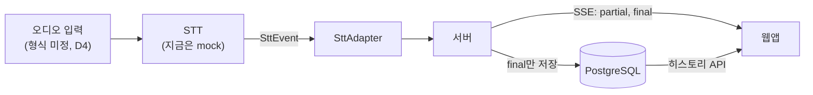

# 프로젝트 설명 — speech-transcriber

마지막 갱신: 2026-10-15 · 이광호

이 문서는 프로젝트가 무엇이고 어떻게 구성되는지 설명합니다. 확정된 내용만 적고, 아직 만들지 않은 부분은 작업 번호와 함께 '예정'으로 표시합니다. 작업 목록과 진행 상황은 [`TODO.md`](../TODO.md)가 기준입니다.

## 무엇을 만드는가

**온디바이스 스피치 트랜스크라이버**입니다. 녹음을 기기 안에서 STT(음성 인식)로 처리해 웹앱과 동기화하는 독립형 기기이고, 하드웨어는 Rubik Pi입니다. 경희대학교 캡스톤디자인(14주, 3인 팀) 프로젝트입니다.

이 저장소는 **앱(웹앱 + 백엔드) 전용**입니다.

| 파트 | 담당 |
| --- | --- |
| 앱(웹앱 + 백엔드) | 이광호 |
| 하드웨어 | 김범수 |
| AI 모델 | 박지윤 |

## 핵심 기능

1. 녹음 → 온디바이스 STT → 노트
2. 실시간 자막/트랜스크립트 화면
3. 세션 히스토리 조회·다운로드

AI 요약, 화자 분리, 검색, 배터리 내장 휴대형, 모드 전환(일반 녹음/AI 질의)은 확장 기능이며 핵심 기능보다 먼저 만들지 않습니다.

## 전체 구성

음성이 텍스트가 되어 화면과 DB에 닿기까지의 흐름입니다.



| 구성 요소 | 위치 | 역할 | 상태 |
| --- | --- | --- | --- |
| STT 어댑터 | `apps/server/src/stt` | STT 구현체와 서버 사이의 경계. 서버의 다른 코드는 `SttAdapter` 인터페이스만 봅니다 | 구현됨 (T05). 구현체는 mock |
| 실제 STT | 미정 | 기기 안에서 음성을 인식합니다 | 예정 (T19 합의 후 T20) |
| 서버 | `apps/server` | 세션 시작/종료, SSE 전달, DB 저장, 히스토리 API | Express 서버가 뜨고 `GET /health`, 공통 에러 응답(`{ error: { code, message } }`), pg 연결 풀이 있음 (T04). 세션 시작·종료 API가 있고 시작하면 mock STT가 켜짐 (T06). final 세그먼트를 DB에 저장함 (T08). 녹음 중인 세션의 이벤트를 SSE로 보냄 (T07). 히스토리 목록·상세 API가 있음 (T10). SSE 재연결 이어받기와 내보내기는 예정 (T09, T11) |
| DB | `docker-compose.yml` (노트북 개발용) | 세션과 세그먼트를 저장합니다 | 로컬 PostgreSQL 16 컨테이너가 뜸 (T02). 스키마와 마이그레이션 있음 (T03). 세션은 저장함 (T06). 세그먼트도 저장함 (T08). 기기에서의 구성은 미정 (D5, D8) |
| 웹앱 | `apps/web` | 녹음 제어, 실시간 트랜스크립트, 히스토리 화면 | 임시 파일만 있음 (T12~T16 예정) |
| 공용 타입 | `packages/shared` | 서버와 웹이 함께 쓰는 타입과 상수 | `APP_NAME`, `SttEvent`, `Session`, `SessionSummary`, `Segment`, `SessionStreamMessage`, `STREAM_HEARTBEAT_MS` |

## 기술 결정

| 항목 | 결정 |
| --- | --- |
| 클라이언트 | React 웹앱 |
| 백엔드 | Node.js + TypeScript, npm workspaces 모노레포 |
| 서버 프레임워크 | Express |
| 실시간 전달 | SSE로 시작, 추후 WebSocket 전환을 고려해 설계 |
| 사용자 모델 | 단일 사용자, 로그인 없음 |
| DB | PostgreSQL, `pg` 라이브러리로 직접 SQL 작성 (ORM 사용 안 함) |
| SSE 끊김 | 자동 재연결 + 화면 상단 배너 알림 |
| 개발 환경 | 노트북에서 먼저 개발. STT·DB 주소는 환경변수로 분리 |
| STT | Node 내부 mock STT로 시작해 실제 STT로 교체 |
| 테스트 | Vitest, 핵심 로직만 |
| 백엔드 위치 | Rubik Pi 안을 목표로 설계. 실측 결과에 따라 SQLite 또는 별도 서버로 바뀔 수 있음 |

아직 정해지지 않은 것은 다음과 같습니다. 결정 번호는 `TODO.md`의 표기입니다.

- 웹앱 빌드 도구 (D3, T12 전)
- STT 호출 방법, 오디오 입력 형식, partial/final 이벤트의 최종 형식 (D4, AI·하드웨어 파트 협의)
- Rubik Pi OS, 입출력 구성, 기기 수령 시점 (D5, 하드웨어 파트 협의)
- 히스토리 다운로드 포맷 (D6, T11 전)
- 팀 전체 마일스톤과 주차별 일정 (D7)
- PostgreSQL 메모리 설정, SQLite 전환 여부 (D8, 기기 실측 후)

## 폴더 구조

```text
speech-transcriber/
├─ TODO.md                    # 작업 목록과 작업 기록
├─ package.json               # npm workspaces, 공통 스크립트
├─ tsconfig.base.json         # 공통 컴파일러 옵션
├─ .env.example               # PORT, DB_URL, STT_URL (복사해서 .env로 씀)
├─ docker-compose.yml         # 로컬 개발용 PostgreSQL 16
├─ apps/
│  ├─ server/                 # @app/server — Node.js 백엔드
│  │  ├─ migrations/
│  │  │  ├─ 001_init.sql      # 스키마 v0 (sessions, segments)
│  │  │  └─ 002_session_status.sql  # sessions.status 컬럼
│  │  └─ src/
│  │     ├─ index.ts          # 진입점 (listen, 남은 세션 정리, 종료 처리)
│  │     ├─ app.ts            # Express 앱 조립 (/health, /api/sessions, 404·에러 처리)
│  │     ├─ config/
│  │     │  └─ env.ts         # 환경변수 로더
│  │     ├─ db/
│  │     │  ├─ pool.ts        # pg 연결 풀
│  │     │  └─ migrate.ts     # 마이그레이션 실행 스크립트
│  │     ├─ http/
│  │     │  ├─ errors.ts      # HttpError, 404·에러 처리 미들웨어
│  │     │  └─ sse.ts         # SSE 응답 하나 (헤더, data 한 줄 JSON, heartbeat)
│  │     ├─ segments/
│  │     │  ├─ repository.ts  # segments 테이블을 읽고 쓰는 SQL
│  │     │  └─ writer.ts      # 세션의 final을 순서대로 쓰고, 실패하면 다시 시도
│  │     ├─ sessions/
│  │     │  ├─ repository.ts  # sessions 테이블 SQL (히스토리 목록 포함)
│  │     │  ├─ manager.ts     # 진행 중인 세션, 상태 전이, STT 어댑터 연결, 세그먼트 저장 연결, 스트림 구독
│  │     │  └─ routes.ts      # 세션 API, 스트림, 히스토리 라우트
│  │     └─ stt/
│  │        ├─ adapter.ts     # SttAdapter 인터페이스
│  │        ├─ mock.ts        # MockSttAdapter
│  │        └─ demo.ts        # mock 이벤트 확인용 스크립트
│  └─ web/                    # @app/web — React 웹앱
├─ packages/
│  └─ shared/                 # @app/shared — 서버·웹 공용 타입과 상수
│     └─ src/
│        ├─ index.ts
│        ├─ segment.ts        # Segment 타입 (저장된 세그먼트)
│        ├─ session.ts        # Session, SessionSummary 타입
│        ├─ stream.ts         # SessionStreamMessage 타입, heartbeat 간격
│        └─ stt.ts            # SttEvent 타입
└─ docs/
   ├─ project-overview.md     # 이 문서
   ├─ guides/                 # 작업별 지침서 (Txx.md)
   └─ logs/                   # 일자별 작업 기록 (YYYY-MM-DD.md)
```

## 실행 방법

Node.js 20 기준으로 개발합니다. DB는 Docker Desktop이 켜져 있어야 뜹니다.

```bash
npm install          # 루트에서 한 번
cp .env.example .env # 처음 한 번. .env가 없으면 dev:server가 실행되지 않음
docker compose up -d # 로컬 PostgreSQL 실행 (끌 때는 docker compose down)
npm run db:migrate   # 아직 적용하지 않은 마이그레이션 실행 (다시 실행해도 안전)
npm run typecheck    # 모든 워크스페이스 타입 검사
npm run dev:server   # 서버 실행 (끌 때는 Ctrl+C)
npm run dev:stt      # mock STT 이벤트를 콘솔에 출력
```

`dev:server`는 `.env`의 `PORT`(예시 값 3000)에서 요청을 받습니다. `curl localhost:3000/health`가 `{"status":"ok"}`를 내면 서버와 DB가 모두 살아 있는 것이고, DB에 연결하지 못하면 503을 냅니다. 없는 경로와 서버 오류는 모두 `{ "error": { "code", "message" } }` 모양의 JSON으로 응답합니다.

`PORT`, `DB_URL`, `STT_URL` 중 빠진 값이 있으면 `dev:server`는 빠진 변수 이름을 알리고 종료 코드 1로 끝납니다. `docker compose down`은 데이터를 지우지 않습니다. 데이터까지 지우려면 `docker compose down -v`를 씁니다.

## 세션 API

녹음 세션을 시작하고 끝내는 API입니다(T06). 단일 사용자라 진행 중인 세션은 한 번에 하나뿐입니다. 성공 응답은 `{ "session": … }`으로 감싸고, 에러는 `{ "error": { "code", "message" } }`로 응답합니다.

| 요청 | 하는 일 | 응답 |
| --- | --- | --- |
| `POST /api/sessions` | 세션을 만들고 STT를 켭니다 | `201`과 세션. 진행 중인 세션이 있으면 `409` `SESSION_ALREADY_ACTIVE` |
| `GET /api/sessions/active` | 진행 중인 세션을 알려 줍니다 | `200`과 세션. 없으면 `{"session":null}` |
| `POST /api/sessions/:id/stop` | STT를 끄고 세션을 닫습니다 | `200`과 세션. 없는 번호면 `404` `SESSION_NOT_FOUND`, 진행 중이 아니면 `409` `SESSION_NOT_ACTIVE`, 번호가 양의 정수가 아니면 `400` `INVALID_SESSION_ID` |

세션은 `{"id":1,"status":"recording","startedAt":"2026-10-13T01:29:37.747Z","endedAt":null}` 모양이고, 타입은 `packages/shared/src/session.ts`의 `Session`입니다.

| `status` | 뜻 |
| --- | --- |
| `recording` | 녹음 중. `endedAt`이 `null`입니다 |
| `ended` | 사용자가 종료했습니다 |
| `interrupted` | 사용자가 종료하지 않았는데 끊겼습니다. 녹음 중에 서버를 끄면 이 상태로 닫히고, 서버가 강제로 꺼져 닫지 못한 세션은 서버를 다시 켤 때 이 상태로 닫힙니다 |

```bash
curl -X POST localhost:3000/api/sessions          # 시작
curl localhost:3000/api/sessions/active           # 진행 중인 세션
curl -X POST localhost:3000/api/sessions/1/stop   # 종료 (1은 시작할 때 받은 id)
```

물리 버튼으로 녹음을 시작하는 경로와, 정지한 뒤 마지막 final을 기다리는 단계는 D4 협의에서 정해지면 추가합니다.

## 실시간 스트림 (SSE)

녹음 중인 세션의 STT 이벤트를 웹앱에 실시간으로 보내는 엔드포인트입니다(T07).

| 요청 | 하는 일 | 응답 |
| --- | --- | --- |
| `GET /api/sessions/:id/events` | 진행 중인 세션의 이벤트를 SSE로 보냅니다 | `200`과 `text/event-stream`. 없는 번호면 `404` `SESSION_NOT_FOUND`, 진행 중이 아니면 `409` `SESSION_NOT_ACTIVE`, 번호가 양의 정수가 아니면 `400` `INVALID_SESSION_ID` (세션 API와 같은 에러 JSON) |

메시지는 모두 SSE의 기본 `message` 이벤트로 오고, `data` 한 줄에 JSON 하나입니다. 종류는 JSON의 `type`으로 구분하고, 타입은 `packages/shared/src/stream.ts`의 `SessionStreamMessage`입니다. 나중에 WebSocket으로 바꿔도 같은 JSON을 보냅니다.

| `type` | 언제 | 내용 |
| --- | --- | --- |
| `partial`, `final` | STT가 이벤트를 낼 때마다 | `SttEvent` 그대로 (아래 'STT 이벤트' 참고) |
| `heartbeat` | 접속한 뒤 15초마다 (`STREAM_HEARTBEAT_MS`) | 없음. 연결이 살아 있다는 표시입니다 |
| `ended` | 세션 종료가 성공했을 때 | `session`: 닫힌 세션. 이 메시지 뒤에 서버가 스트림을 닫습니다 |

```text
data: {"type":"partial","segmentId":0,"text":"안녕하세요","startMs":0,"endMs":200}

data: {"type":"final","segmentId":0,"text":"안녕하세요 오늘 회의를 시작하겠습니다","startMs":0,"endMs":800}

data: {"type":"heartbeat"}

data: {"type":"ended","session":{"id":17,"status":"ended","startedAt":"2026-10-15T02:13:00.575Z","endedAt":"2026-10-15T02:13:06.625Z"}}
```

```bash
curl -X POST localhost:3000/api/sessions        # 시작. 응답의 id를 아래에 씀
curl -N localhost:3000/api/sessions/1/events    # 스트림 (-N은 받는 대로 출력)
```

브라우저에서는 `EventSource`로 받습니다.

```ts
import type { SessionStreamMessage } from '@app/shared';

const source = new EventSource(`/api/sessions/${id}/events`);
source.onmessage = (event) => {
  const message: SessionStreamMessage = JSON.parse(event.data);
  if (message.type === 'ended') source.close();
  // partial, final은 'STT 이벤트'의 화면 처리대로 그린다. heartbeat는 무시해도 된다.
};
```

- **접속한 뒤의 이벤트만 옵니다.** 녹음 도중에 접속하거나 새로고침하면 그 전 문장은 오지 않습니다. 재접속 때 빠진 이벤트를 채우는 것은 T09, 지난 세션은 히스토리 API(T10)입니다.
- **여러 곳에서 동시에 접속할 수 있고**, 모두 같은 이벤트를 받습니다.
- **종료가 실패하면**(예: DB가 꺼짐) 스트림은 닫히지 않고 heartbeat만 옵니다. 다시 종료해 성공하면 `ended`가 옵니다.
- **서버를 끄면** `ended` 없이 스트림이 끊깁니다. 세션은 `interrupted`로 닫힙니다.
- **`EventSource`는 끊기면 스스로 다시 접속합니다.** 끝난 세션에 다시 접속하면 `409`를 받고 멈춥니다. 끊김 표시(상단 배너)와 재연결 정책은 T15입니다.
- **CORS는 아직 없습니다.** 웹앱을 다른 포트에서 띄울 때의 처리는 T12에서 정합니다.

## 히스토리 API

지난 녹음을 보는 API입니다(T10). DB에 저장된 내용만 읽습니다.

| 요청 | 하는 일 | 응답 |
| --- | --- | --- |
| `GET /api/sessions` | 히스토리 목록 | `200`과 `{ "sessions": [...] }`. 끝난 세션(`ended`, `interrupted`) 중 세그먼트가 있는 것만, 최근에 시작한 것부터 전부. 녹음 중인 세션과 세그먼트가 없는 세션은 빠집니다 |
| `GET /api/sessions/:id` | 한 세션의 저장된 내용 | `200`과 `{ "session": …, "segments": [...] }`. 세그먼트는 순서대로. 녹음 중이거나 세그먼트가 없는 세션도 응답합니다. 없는 번호면 `404` `SESSION_NOT_FOUND`, 번호가 양의 정수가 아니면 `400` `INVALID_SESSION_ID` |

목록의 항목은 세션에 두 필드를 더한 `SessionSummary`이고, 상세의 세그먼트는 `Segment`입니다. 둘 다 `packages/shared`에 있습니다.

| 필드 | 담는 값 |
| --- | --- |
| `segmentCount` | 저장된 세그먼트 개수 |
| `preview` | 첫 세그먼트의 `text`. 자르지 않고 보냅니다 |
| `segments[]` | `segmentId`, `text`, `startMs`, `endMs`. `segments` 테이블 한 행입니다 |

```bash
curl localhost:3000/api/sessions      # 목록
curl localhost:3000/api/sessions/7    # 상세 (7은 목록의 id)
```

```json
{"sessions":[{"id":23,"status":"ended","startedAt":"2026-10-15T02:16:29.993Z","endedAt":"2026-10-15T02:16:36.460Z","segmentCount":7,"preview":"안녕하세요 오늘 회의를 시작하겠습니다"}]}
```

- **녹음 중인 세션의 상세는 DB에 저장된 세그먼트만 보여 줍니다.** 실시간 내용은 스트림으로 봅니다.
- **서버가 강제로 꺼진 세션은 `endedAt`이 서버를 다시 켠 시각입니다.** `endedAt - startedAt`으로 길이를 세면 실제보다 길게 나옵니다. 보정할지는 T16 전에 정합니다.
- **DB가 꺼져 있으면 `500`입니다.** 다른 세션 API와 같습니다.

## DB 스키마

스키마는 `apps/server/migrations/`의 SQL 파일로 관리합니다. 바꿀 때는 다음 번호의 파일을 추가하고, 이미 적용한 파일은 고치지 않습니다. 지금은 `002_session_status.sql`까지 있습니다.

| 테이블 | 컬럼 | 담는 것 |
| --- | --- | --- |
| `sessions` | `id`, `started_at`, `ended_at`, `status` | 녹음 세션 하나가 한 행입니다. `id`는 자동으로 증가하는 정수입니다. `status`는 `recording`, `ended`, `interrupted` 중 하나이고, `recording`인 행만 `ended_at`이 비어 있습니다 |
| `segments` | `session_id`, `segment_id`, `text`, `start_ms`, `end_ms` | final 이벤트 하나가 한 행입니다. 기본 키는 `(session_id, segment_id)`이고, 세션을 지우면 함께 지워집니다. 같은 키의 final이 다시 오면 나중 값으로 덮어씁니다 |
| `schema_migrations` | `name`, `applied_at` | 적용한 마이그레이션 파일 이름. 실행 스크립트가 관리합니다 |

`segments`의 컬럼은 아래 STT 이벤트 초안을 따르므로, T19 합의에서 형식이 바뀌면 마이그레이션을 추가해 맞춥니다.

세그먼트는 녹음 중에 final이 올 때마다 바로 한 행씩 들어갑니다(T08). 저장한 내용은 아래로 확인합니다. `1`은 세션 번호입니다.

```bash
docker compose exec db psql -U user -d transcriber -c 'select segment_id, text, start_ms, end_ms from segments where session_id = 1 order by segment_id'
```

녹음 중에 DB에 닿지 못하면 그동안의 final은 서버 메모리에 쌓였다가, DB가 돌아온 뒤 다음 final이 올 때나 종료할 때 순서대로 저장됩니다. 종료할 때도 쓰지 못하면 `POST /api/sessions/:id/stop`이 500을 내고 세션은 녹음 중으로 남으며, DB가 돌아온 뒤 다시 종료하면 저장됩니다. 서버를 끌 때까지 쓰지 못한 세그먼트는 잃습니다.

## STT 이벤트

STT 이벤트는 STT가 "방금 이만큼 인식했다"고 서버에 알리는 메시지 하나입니다. 타입은 `packages/shared/src/stt.ts`의 `SttEvent`이고, 서버와 웹이 같은 타입을 씁니다.

지금 형식은 **초안**입니다. 최종 형식은 T19에서 AI 파트(박지윤), 하드웨어 파트(김범수)와 합의해 확정하며, 실제 STT가 내주는 형식에 따라 바뀔 수 있습니다.

### 필드

| 필드 | 타입 | 담는 값 |
| --- | --- | --- |
| `type` | `'partial'` \| `'final'` | 결과가 확정인지 여부. partial은 아직 바뀔 수 있는 중간 결과, final은 확정된 결과 |
| `segmentId` | `number` | 몇 번째 세그먼트(문장 단위 덩어리)인지. 세션 안에서 0부터 1씩 증가하고, 같은 세그먼트의 partial과 final은 같은 번호 |
| `text` | `string` | 그 세그먼트의 시작부터 지금까지 인식된 전체 텍스트. 새로 추가된 단어만 보내지 않음 |
| `startMs` | `number` | 세그먼트가 시작된 시각. 세션 시작을 0으로 한 밀리초 |
| `endMs` | `number` | 이 이벤트 시점까지의 끝 시각. 같은 기준의 밀리초 |

한 세그먼트 안에서 값이 움직이는 방식은 다음과 같습니다.

- `segmentId`와 `startMs`는 바뀌지 않습니다.
- `text`는 길어지고 `endMs`는 커집니다.
- partial이 몇 번 온 뒤 final이 한 번 오면 그 세그먼트는 끝납니다. 다음 이벤트는 `segmentId`가 1 큰 새 세그먼트입니다.

### 예시: 한 문장이 인식될 때

"안녕하세요 오늘 회의를 시작하겠습니다"는 이벤트 4개로 옵니다.

| 순서 | `type` | `segmentId` | `text` | `startMs` | `endMs` |
| --- | --- | --- | --- | --- | --- |
| 1 | partial | 0 | 안녕하세요 | 0 | 200 |
| 2 | partial | 0 | 안녕하세요 오늘 | 0 | 400 |
| 3 | partial | 0 | 안녕하세요 오늘 회의를 | 0 | 600 |
| 4 | final | 0 | 안녕하세요 오늘 회의를 시작하겠습니다 | 0 | 800 |

다음 문장은 `segmentId` 1, `startMs` 800으로 시작합니다. `npm run dev:stt`로 세 문장의 이벤트 14개를 직접 볼 수 있습니다.

```text
[stt] partial #0 0-200ms 안녕하세요
[stt] partial #0 0-400ms 안녕하세요 오늘
[stt] partial #0 0-600ms 안녕하세요 오늘 회의를
[stt] final   #0 0-800ms 안녕하세요 오늘 회의를 시작하겠습니다
[stt] partial #1 800-1000ms 첫
[stt] partial #1 800-1200ms 첫 번째
[stt] partial #1 800-1400ms 첫 번째 안건은
[stt] partial #1 800-1600ms 첫 번째 안건은 일정
[stt] final   #1 800-1800ms 첫 번째 안건은 일정 공유입니다
[stt] partial #2 1800-2000ms 다음
[stt] partial #2 1800-2200ms 다음 주까지
[stt] partial #2 1800-2400ms 다음 주까지 초안을
[stt] partial #2 1800-2600ms 다음 주까지 초안을 정리해
[stt] final   #2 1800-2800ms 다음 주까지 초안을 정리해 주세요
[stt] stopped - partial 11개, final 3개
```

### 이벤트를 쓰는 곳

| 단계 | 하는 일 | 쓰는 필드 | 상태 |
| --- | --- | --- | --- |
| 만들기 | `SttAdapter` 구현체가 인식 결과가 생길 때마다 이벤트를 만들어 `onEvent`로 넘깁니다 | 전부 | 구현됨 (T05, mock) |
| 화면으로 보내기 | 서버가 받은 이벤트를 SSE로 웹앱에 전달합니다 | 전부 | 구현됨 (T07) |
| 화면에 그리기 | 같은 `segmentId`의 줄을 새 `text`로 덮어씁니다. `type`으로 확정 여부를 구분합니다 | `type`, `segmentId`, `text` | 예정 (T14) |
| DB에 저장하기 | `type`이 final인 이벤트만 저장합니다. 세그먼트당 한 행이 됩니다 | 전부 | 구현됨 (T08) |
| 히스토리 보여 주기 | 저장한 세그먼트를 순서대로 읽어 보여 줍니다. `startMs`와 `endMs`로 문장별 시각을 표시할 수 있습니다 | `segmentId`, `text`, `startMs`, `endMs` | API 구현됨 (T10), 화면은 예정 (T16) |

서버 코드에서 어댑터를 쓰는 방법입니다. 변수 타입을 `SttAdapter`로 두면 나중에 실제 STT로 바꿀 때 `new MockSttAdapter()` 한 곳만 바뀝니다.

```ts
import type { SttAdapter } from './stt/adapter';
import { MockSttAdapter } from './stt/mock';

const adapter: SttAdapter = new MockSttAdapter();

await adapter.start((event) => {
  // event.type, event.segmentId, event.text, event.startMs, event.endMs
});

await adapter.stop();
```

### 예시: 화면과 DB에서 일어나는 일

위 예시의 이벤트가 순서대로 들어올 때 화면이 바뀌는 모습입니다. 화면은 T14에서 만들 예정이며, 아래는 이 형식이 의도한 처리 방식입니다.

| 받은 이벤트 | 화면의 트랜스크립트 |
| --- | --- |
| partial #0 `안녕하세요` | 1번 줄: 안녕하세요 (미확정) |
| partial #0 `안녕하세요 오늘` | 1번 줄: 안녕하세요 오늘 (미확정) |
| partial #0 `안녕하세요 오늘 회의를` | 1번 줄: 안녕하세요 오늘 회의를 (미확정) |
| final #0 `안녕하세요 오늘 회의를 시작하겠습니다` | 1번 줄: 안녕하세요 오늘 회의를 시작하겠습니다 (확정) |
| partial #1 `첫` | 1번 줄은 그대로, 2번 줄: 첫 (미확정) |

`text`가 누적된 전체 텍스트라서 화면은 이어 붙이는 계산 없이 줄을 통째로 바꾸면 됩니다. STT가 앞 단어를 고쳐서 다시 보내도 그대로 반영됩니다.

세 문장이 모두 끝났을 때 DB에 남는 것은 final 3개입니다. partial 11개는 저장하지 않습니다.

| `segmentId` | `text` | `startMs` | `endMs` |
| --- | --- | --- | --- |
| 0 | 안녕하세요 오늘 회의를 시작하겠습니다 | 0 | 800 |
| 1 | 첫 번째 안건은 일정 공유입니다 | 800 | 1800 |
| 2 | 다음 주까지 초안을 정리해 주세요 | 1800 | 2800 |

### 알아 둘 점

- **mock의 시각은 실제 오디오 시각이 아닙니다.** 오디오가 없어서 단어 하나당 200ms씩 더한 값입니다.
- **mock은 문장 목록을 반복합니다.** 세 문장이 끝나면 첫 문장으로 돌아가 `stop()`을 부를 때까지 계속하고, `segmentId`는 계속 증가합니다. `npm run dev:stt`는 한 바퀴 뒤에 스스로 멈춥니다.
- **초안에 없는 값이 있습니다.** 세션 ID, 화자 구분, 인식 신뢰도, 언어는 이벤트에 없습니다. 세션과 이벤트는 서버가 묶습니다(T06). 서버가 세션마다 어댑터를 새로 만들고, 그 어댑터가 준 이벤트를 그 세션의 것으로 봅니다. 나머지는 D4 협의에서 정합니다.
- **final이 오지 않은 세그먼트는 저장되지 않습니다.** 문장 중간에 녹음을 종료하면 그 문장은 DB에 없습니다. 실제 STT가 정지할 때 마지막 final을 내주는지는 D4 협의에서 정합니다.
- **오디오를 넘기는 방법은 인터페이스에 없습니다.** `SttAdapter.start`는 이벤트 핸들러만 받습니다. 오디오 입력 형식이 D4에서 정해지면 인자가 바뀔 수 있습니다.

## 관련 문서

- [`TODO.md`](../TODO.md): 작업 목록, 우선순위, 팀원 합의가 필요한 항목, 작업 기록
- [`docs/guides/`](guides/): 작업별 지침서. STT 어댑터는 [`T05.md`](guides/T05.md), 세션 API는 [`T06.md`](guides/T06.md), SSE 스트림은 [`T07.md`](guides/T07.md), 세그먼트 저장은 [`T08.md`](guides/T08.md), 히스토리 API는 [`T10.md`](guides/T10.md)
- [`docs/d4-stt-questions.md`](d4-stt-questions.md): D4 협의에서 AI·하드웨어 파트에 물어볼 질문 목록
- [`docs/logs/`](logs/): 일자별 작업 기록
